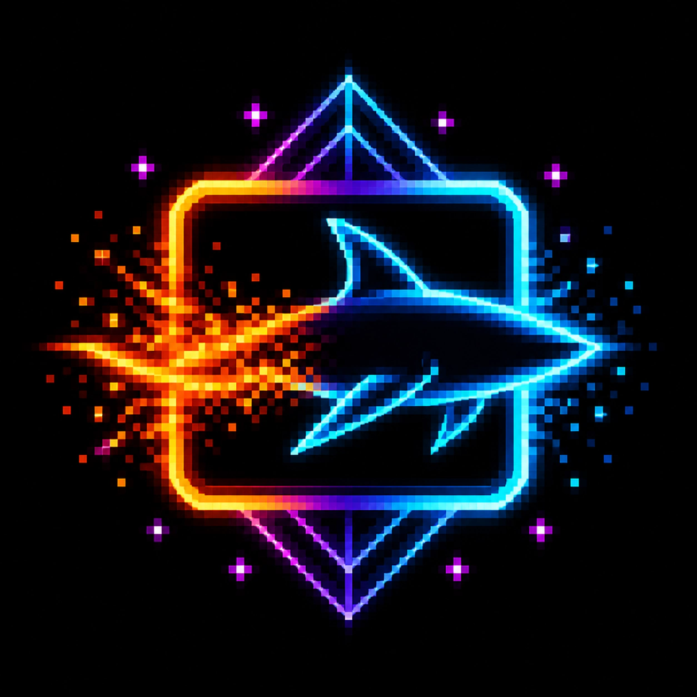

# framegen-vulkan

<p align="center">
  
</p>

framegen-vulkan is a Vulkan layer for Frame Generation, spatial scaling, and optional shader effects on SteamOS and Linux. It supports LSFG Fixed and Adaptive Frame Generation, LS1 scaling, and the open framegen-vulkan Scaler. **framegen-vulkan Scaler and shaders work without Lossless Scaling.**

LSFG and LS1 require a lawful, user-supplied <a href="https://store.steampowered.com/app/993090/Lossless_Scaling/" target="_blank" rel="noopener noreferrer">Lossless Scaling</a> installation. framegen-vulkan does not distribute or modify `Lossless.dll`; the open framegen-vulkan Scaler and bundled shaders do not require it. framegen-vulkan descends from the GPL-3.0-or-later lsfg-vk version 2 tree. See the <a href="../THIRD_PARTY_NOTICES.md" target="_blank" rel="noopener noreferrer">third-party notices</a> and <a href="../LICENSE.md" target="_blank" rel="noopener noreferrer">license</a> for lineage and redistribution terms.

## Downloads

Download packages from the <a href="https://github.com/eugeniosegala/MAKO/releases/tag/render-v4.6.0" target="_blank" rel="noopener noreferrer">latest framegen-vulkan release</a>:

| Release file | Use it for |
| --- | --- |
| `framegen-vulkan-v<version>-linux.tar.xz` | Direct Linux or SteamOS installation, with 64-bit/32-bit layers and the command-line tools |
| `framegen-vulkan-bin-<version>-<pkgrel>-x86_64.pkg.tar.zst` | A system-wide installation on writable Arch Linux systems; see the [Arch guide](dist/arch/README.md#install-the-release-package) |
| `framegen-vulkan-v<version>-flatpaks.tar.xz` | Vulkan runtime extensions for Flatpak games, launchers, and emulators |

GitHub's automatic **Source code** archives are not installable Renderer packages.

## Installation

For Frame Generation or LS1, install the default public version of Lossless Scaling through Steam first. For framegen-vulkan Scaler or Shaders without it, turn Frame Generation off and follow the same steps below.

### Arch Linux package

On a writable x86_64 Arch Linux system with the multilib repository enabled, download the matching `.pkg.tar.zst` release asset and leave it unextracted. Open a terminal in the folder containing the downloaded file, then run this command with the exact downloaded filename:

```bash
sudo pacman -U ./framegen-vulkan-bin-X.Y.Z-1-x86_64.pkg.tar.zst
```

The `./` prefix refers to the terminal's current folder; the command does not download the package. If the file is elsewhere, use its full path instead.

See the [Arch guide](dist/arch/README.md#install-the-release-package) for launch options, upgrades, removal, and user-local installation conflicts.

### Direct Linux installation

Extract `framegen-vulkan-v<version>-linux.tar.xz` into a new folder and run **Install framegen-vulkan** from that folder. The installer places framegen-vulkan under `~/.local`, preserves existing profiles, and shows the required launch option. Run it again to update. To remove the native installation, run `~/.local/bin/fgvk-installer --uninstall`.

Close games using framegen-vulkan before installing or updating. Flatpak applications require a matching runtime extension and per-application sandbox preparation. Follow the [Flatpak guide](docs/FLATPAK-GUIDE.md); a host `fgvk-launch` command cannot replace that setup.

## Usage

**A profile does not activate framegen-vulkan. Every standalone native Steam or Proton game must start through `fgvk-launch`.** Set the launch option once for each game, then use Steam normally.

### Native Steam or Proton game

1. Create a profile in `~/.config/framegen-vulkan/conf.toml` and set `active_in` to the game's executable, such as `Game.exe`. Check the file with `~/.local/bin/fgvk-cli validate`. The [configuration guide](docs/CONFIGURATION.md) has a complete example.
2. Enable Frame Generation, scaling, and/or shader effects in that profile. Settings marked as restart-only take effect the next time the game starts.
3. Add this under **Steam Properties > General > Launch Options**, then start the game with Steam's **Play** button:

    ```text
    ~/.local/bin/fgvk-launch %command%
    ```

When shaders are enabled, the same launch option also sets `ENABLE_VKBASALT=1` as described in [Shaders](docs/CONFIGURATION.md#shaders). If no profile matches, framegen-vulkan stays inactive.

### Other launch types

For native Steam Remote Play, close streams and run `~/.local/bin/fgvk-remote-play status` on the receiving x86_64 Linux device to check the override. `~/.local/bin/fgvk-remote-play restore-before-uninstall` removes it while retaining profiles; run it before removing a system package or manually deleting Renderer files. Requires system Python 3.11 or newer. See [Configuration](docs/CONFIGURATION.md#native-steam-remote-play) for the saved-profile behaviour.

| Game or application | How to start it |
| --- | --- |
| Direct desktop command | `~/.local/bin/fgvk-launch "/path/to/program"` |
| Native Heroic or Lutris game | Use the absolute `fgvk-launch` path as its wrapper or command prefix |
| Flatpak game, launcher, or emulator | Complete the [Flatpak setup](docs/FLATPAK-GUIDE.md), then launch it normally |

`%command%` is a Steam placeholder and must not be typed into a terminal. framegen-vulkan operates on Vulkan; Proton games work through DXVK or VKD3D-Proton, while OpenGL applications require the optional Zink setting in `launcher.conf`.

For every field and environment variable, see [Advanced configuration](docs/CONFIGURATION-REFERENCE.md). To validate a configuration or collect a focused report, run:

```bash
~/.local/bin/fgvk-cli validate
~/.local/bin/fgvk-diagnostics
```

## In-game considerations

- Try the game's V-Sync setting both on and off and keep the smoother option for that game.
- For scaling, try different in-game resolutions and display modes. Check that the game presents a smaller input than the output; Fullscreen, Borderless Fullscreen, and Windowed can differ by game.
- Change Frame Generation, scaling, and shader effects one at a time when checking image quality or performance.

See [Scaling](docs/SCALING.md) for resolution and presentation details, or [Troubleshooting](docs/TROUBLESHOOTING.md) when framegen-vulkan does not activate or present correctly.

## Frame Generation profiling

Use `fgvk-cli benchmark --profile` for opt-in CPU submission/wait timings and GPU preprocessing/output timestamp spans. See [Frame Generation profiling](docs/FRAME-PROFILING.md) for arguments, warm-up guidance, output records and measurement limits.

## Build from source

From `engine/`, build a standard development configuration with CMake and Vulkan development headers:

```bash
cmake -S . -B build -DCMAKE_BUILD_TYPE=Release
cmake --build build
ctest --test-dir build --output-on-failure
```

See [Building from source](docs/BUILDING-FROM-SOURCE.md) for prerequisites, SteamOS builds, 32-bit layers, and installation prefixes.

For host, Flatpak, Arch, or complete local packages, choose an entry point in [Building from source](docs/BUILDING-FROM-SOURCE.md#choose-the-right-build-path). Packaging writes to `engine/out/` without publishing.

## More documentation

- [Renderer code map](docs/RENDERER-ARCHITECTURE.md): component owners and presentation file boundaries.
- [Configuration](docs/CONFIGURATION.md): profiles, game launch setup, and runtime behaviour.
- [Advanced configuration](docs/CONFIGURATION-REFERENCE.md): TOML fields, defaults, and environment variables.
- [Runtime transitions](docs/RUNTIME-TRANSITIONS.md): live, deferred, and restart-required changes.
- [Scaling](docs/SCALING.md): spatial scaling setup, behavior, and limitations.
- [Adaptive validation](docs/ADAPTIVE-VALIDATION.md): Adaptive scheduling and validation.
- [Optional graphics integrations](docs/LAYER-CHAINING.md): bundled vkBasalt chaining and isolation.
- [Flatpak guide](docs/FLATPAK-GUIDE.md): runtime extensions and application preparation.
- [Videos with framegen-vulkan](docs/VIDEOS_WITH_FGVK.md): Frame Generation and scaling with mpv.
- [Troubleshooting](docs/TROUBLESHOOTING.md): activation, presentation, and diagnostics.
- [Collect diagnostics](docs/COLLECT_DIAGNOSTICS.md): create a standalone support report.
- [Building from source](docs/BUILDING-FROM-SOURCE.md): development and packaging requirements.
